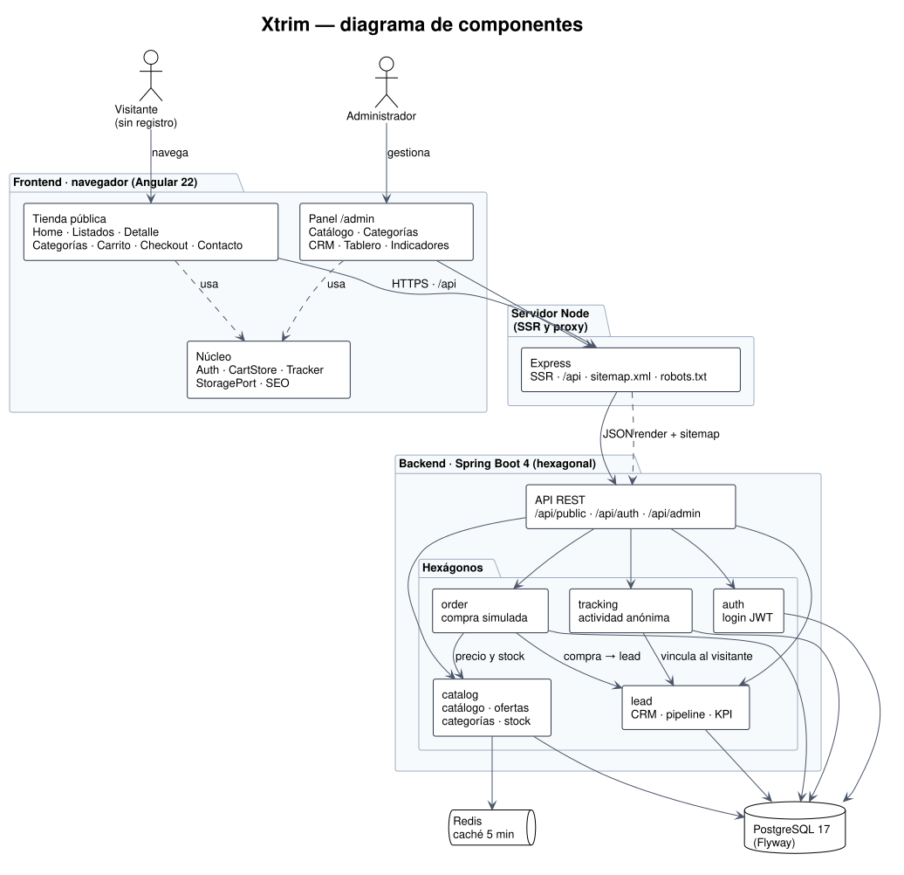
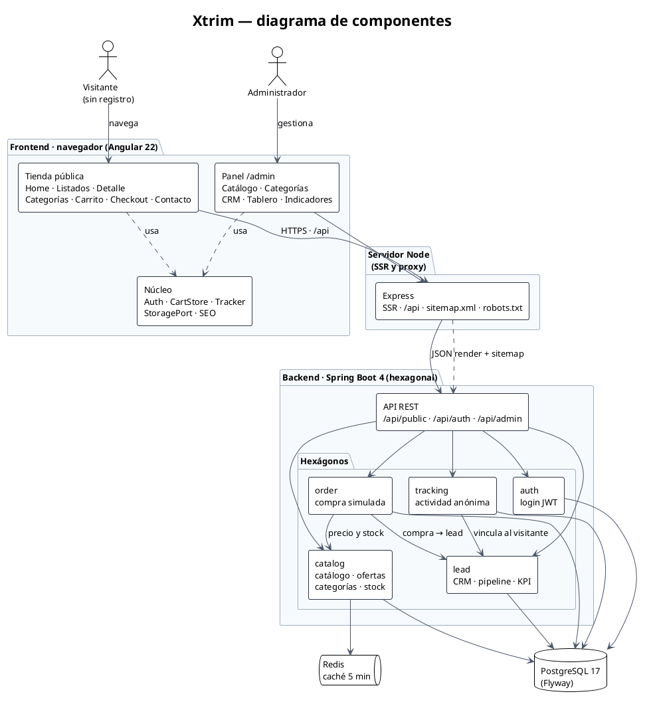

# Xtrim — Ecommerce + CRM de leads

**Un catálogo de productos y servicios que convierte la visita anónima en un lead con historia.**
Se compra sin registrarse. Cuando la persona deja su correo, el CRM ya sabe qué buscó, qué vio, qué
agregó al carrito y qué compró.

> **La tesis:** una tienda pequeña puede ser un motor de leads. El catálogo es la superficie; el
> activo es el CRM. Un `anonymous_id` (un UUID en el navegador) une toda la actividad, y el lead es
> un *enriquecimiento* de esa actividad, nunca un requisito para entrar.

**Stack:** Spring Boot 4 (Java 25) · Angular 22 con SSR · PostgreSQL 17 · Redis · Docker.

**Panel:** `admin@xtrim.ec` / `admin123`

---

## Cómo funciona (en 4 pasos)

1. **Entra y navega.** Busca, filtra, abre un producto o servicio. No hay registro.
2. **Hace algo con intención.** Agrega al carrito, compra, pide información o pide un aviso de stock.
3. **Deja su correo.** El correo es la identidad: nace el lead y toda su actividad anterior se une a él.
4. **El CRM lo trabaja.** El equipo lo mueve por el pipeline, deja notas y lee su línea de tiempo.

---

## Diagrama de componentes



**Cómo leerlo:**

- El navegador llama siempre a `/api` en su propio origen. En producción el servidor Node lo
  reenvía a la API; en desarrollo lo hace `ng serve`. Ese mismo servidor Node renderiza el sitio,
  el `sitemap.xml` y el `robots.txt`.
- El backend es **hexagonal**: cinco funcionalidades separadas (`catalog`, `order`, `tracking`,
  `lead`, `auth`). La compra consulta el catálogo y crea el lead; el tracking enlaza al visitante
  con su lead y el CRM lee esa actividad como línea de tiempo.
- **PostgreSQL** es la fuente de verdad (esquema versionado con Flyway). **Redis** solo cachea el
  catálogo durante cinco minutos.

El diagrama se genera con **PlantUML**. La fuente editable está en
[`docs/diagrama-componentes.puml`](docs/diagrama-componentes.puml) y el código está aquí debajo.

<details>
<summary>Ver el código PlantUML</summary>



</details>

---

## Cómo levantarlo

### Requisitos

| Herramienta | Versión | Para qué |
| --- | --- | --- |
| Docker + Compose | reciente (Compose 2.20+) | **La pila completa**; no hace falta Java ni Node |
| Java | 25 | Solo para el desarrollo en el host |
| Node.js | 22 o superior | Solo para el desarrollo en el host |

### Un comando (Docker Compose)

```bash
cp .env.example .env
openssl rand -base64 48        # pega el resultado en JWT_SECRET
scripts/stack.sh up            # construye y espera a que todo esté sano
scripts/stack.sh smoke         # tienda, proxy /api, login, panel, robots y sitemap
```

| Dónde | URL |
| --- | --- |
| Tienda | <http://localhost:4200> |
| Panel | <http://localhost:4200/admin/login> |
| API | <http://localhost:8080/api/health> |
| Documentación de la API | <http://localhost:8080/swagger-ui/index.html> |

`scripts/stack.sh status` dice cómo está cada pieza, `logs` sigue los logs y `down` la para
**conservando** la base de datos. `reset` es el único comando que borra el volumen (pide
confirmación). Si un puerto está ocupado, cámbialo en `.env` (`SERVER_PORT`, `WEB_PORT`) o
pásalo en el comando: `SERVER_PORT=18081 WEB_PORT=14200 scripts/stack.sh up`.

La pila usa los mismos `Dockerfile`s que Render, arranca en orden por *healthchecks* y no
necesita Maven ni Node en el host. La primera construcción descarga las dependencias; las
siguientes reutilizan la caché de BuildKit.

### Desarrollo en el host

```bash
cp .env.example .env
cd frontend && npm ci && cd ..  # dependencias (solo la primera vez)
scripts/dev.sh start            # pila de datos, API y sitio con recarga
```

`scripts/dev.sh status` y `scripts/dev.sh stop` completan el ciclo. Esta vía es la del
desarrollo diario (Maven + Angular dev server); la de Compose es la del despliegue.

### Paso a paso

```bash
cp .env.example .env                    # configuración
docker compose up -d                    # PostgreSQL + Redis (solo infraestructura)
cd backend && ./mvnw spring-boot:run    # API   → http://localhost:8080
cd frontend && npm ci && npm start      # sitio → http://localhost:4200
```

> Kafka es infraestructura opcional y **no** arranca por defecto: ningún caso de uso lo necesita.
> Si se quiere levantar: `docker compose --profile kafka up -d`.
>
> `docker compose up -d` levanta solo PostgreSQL y Redis. La aplicación completa es
> `docker compose --profile app up -d` (o `scripts/stack.sh up`).

---

## Qué incluye

### Tienda pública (sin registro)

- **Catálogo unificado** — productos y servicios son una sola entidad con un tipo; todo lo demás
  aplica a ambos.
- **Búsqueda y filtros** — ignora mayúsculas y tildes; filtro por categoría, seis ordenamientos,
  «solo ofertas», «poco stock» y paginación.
- **Home** — carrusel de destacados, servicios, productos, más vendidos y ofertas vigentes.
- **Detalle** — galería, especificaciones, oferta con el precio original tachado y cuatro llamadas:
  agregar al carrito, comprar ahora, pedir información y contactar por WhatsApp. Si no hay stock,
  se puede pedir un aviso.
- **Carrito y compra simulada** — el carrito sobrevive a una recarga y no deja pedir más de lo que
  hay. El checkout descuenta el stock de forma atómica y convierte al cliente en lead.
- **Contacto** — formulario con provincia y consentimiento; crea o actualiza el lead por correo.
- **SEO técnico** — SSR de las páginas públicas, metas y canonical dinámicos, JSON-LD, `sitemap.xml`
  y `robots.txt` que bloquea el panel.

### Panel de administración (`ADMIN`)

El rol se valida en el backend: sin un JWT de `ADMIN`, el panel no recibe datos.

- **Catálogo** — crear, editar, activar/inactivar, borrado lógico y descuentos.
- **Categorías** — crear, editar y eliminar.
- **Leads** — listado con filtros (texto, estado y origen) y ficha con línea de tiempo, pedidos,
  notas e historial de estados.
- **Tablero** — Kanban de tres columnas con arrastrar y soltar; el servidor valida cada transición.
- **Indicadores** — ventas cerradas, ganados/perdidos, conversión, importe potencial y leads por
  estado.

---

## Arquitectura

- **Backend hexagonal, feature-first.** Cada funcionalidad (`catalog`, `order`, `tracking`, `lead`,
  `auth`) separa la API HTTP, los casos de uso, el dominio y los adaptadores. El dominio no conoce
  Spring ni JPA. Las dependencias apuntan siempre hacia dentro; un test de ArchUnit lo comprueba en
  cada build.
- **Frontend Angular 22 con SSR.** Componentes standalone y signals. Las lecturas HTTP viven en
  servicios `*Api` y devuelven recursos; el núcleo del cliente reúne autenticación, carrito,
  tracking, almacenamiento y SEO. Las páginas públicas se renderizan en el servidor; `/admin` solo
  se renderiza en el cliente y lleva `noindex`.
- **Datos.** Flyway es dueño del esquema y Hibernate solo valida. El detalle está en
  [`docs/modelo-de-datos.md`](docs/modelo-de-datos.md).

### Reglas que el código no puede romper

| Regla | Por qué |
| --- | --- |
| **El backend calcula el precio** | El cliente nunca envía un precio; las ofertas se calculan al leer. |
| **La máquina de estados vive en el servidor** | `Nuevo → En gestión → Cerrado` y reapertura; `Nuevo → Cerrado` no existe. |
| **El visitante es anónimo primero** | Sin registro obligatorio; el lead llega después y enriquece la actividad. |
| **`stock = NULL` no es `stock = 0`** | `NULL` significa «no se controla» (servicios); solo `0` es «sin stock». |
| **Borrado lógico** | Un ítem eliminado conserva su fila y el historial de pedidos que lo referencian. |
| **Todo está paginado** | Cada listado, público e interno. |

---

## API

| Prefijo | Acceso | Qué hay |
| --- | --- | --- |
| `/api/public` | abierto | `home`, `catalog`, `catalog/{slug}`, `categories`, `events`, `info-requests`, `stock-subscriptions`, `orders` |
| `/api/auth` | abierto | `login` → JWT |
| `/api/admin` | `ADMIN` | `catalog`, `categories`, `leads`, `leads/{id}/status`, `leads/{id}/notes`, `leads/kanban`, `leads/kpis` |

Las listas usan `page` (desde 0) y `size` (máximo 50):

```json
{ "content": [], "page": 0, "size": 12, "totalElements": 0, "totalPages": 0 }
```

Los errores tienen una sola forma en toda la API:

```json
{ "code": "INSUFFICIENT_STOCK", "message": "…", "details": [], "timestamp": "…" }
```

---

## Pruebas

```bash
cd backend && ./mvnw verify   # unitarias + integración con Testcontainers
cd frontend && npm test       # unitarias
```

La integración del backend levanta su propio PostgreSQL, Redis y Kafka, así que no depende de la
pila de `compose`.

El rendimiento está medido en móvil: Lighthouse **94** en la home, **94** en el listado y **87** en
el detalle, con CLS 0. `scripts/lighthouse.sh` repite la medición.

---

## Despliegue

### Docker Compose (local o un servidor)

`compose.yaml` tiene dos perfiles:

| Comando | Qué levanta |
| --- | --- |
| `docker compose up -d` | PostgreSQL y Redis |
| `docker compose --profile app up -d --build --wait` | **todo**: sitio, API, PostgreSQL y Redis |
| `docker compose --profile kafka up -d` | añade Kafka (opcional, sin casos de uso) |

Las dos imágenes de la aplicación se construyen desde los mismos `Dockerfile`s que usa Render.
Los puertos publicados se quedan en `127.0.0.1`; para exponerlos en un servidor hay que cambiar
el bind y poner delante TLS/dominio. `scripts/stack.sh` envuelve el ciclo completo (`up`, `smoke`,
`status`, `logs`, `down`, `reset`).

### Render

[`render.yaml`](render.yaml) describe las cuatro piezas en Render: el sitio (Docker + Node SSR), la
API (Docker), PostgreSQL administrado y Key Value (la caché). Los pasos completos —Blueprint,
variables, verificación y límites del plan gratuito— están en
[`docs/despliegue.md`](docs/despliegue.md). Los secretos se configuran en el panel de Render, nunca
en el repositorio. La URL pública del demo se añade aquí cuando el despliegue esté completado.

Resumen: sube el repositorio, **New + → Blueprint** en Render, elige el repo y pulsa **Apply**. El
blueprint conecta solo las cuatro piezas; `JWT_SECRET` se genera y las credenciales de la base se
inyectan. Después se comprueban `https://<sitio>/`, `/api/health`, `/robots.txt` y `/sitemap.xml`.

---

## Preguntas del caso práctico (resumen)

**1. El tráfico orgánico cae un 40 %.** Primero se descarta una caída del sitio (5xx, latencia,
despliegue roto); después se revisan Search Console, el `sitemap.xml` y el `robots.txt`. Lo más
frecuente es una desindexación o un SSR que entrega HTML vacío.

**2. El formulario falla de forma intermitente.** Se separa el fallo del cliente del del servidor.
La causa típica es la carrera del alta por correo: dos peticiones con el mismo email. Se resuelve
con un `upsert` atómico (`INSERT … ON CONFLICT`) y sacando el tracking de la transacción.

**3. El sitio va lento en móviles.** Se mide con Lighthouse móvil, no de escritorio, y se ataca el
peso de CSS/JS, las fuentes y las imágenes. Aquí ya se hizo: 94/94/87 y CLS 0.

**Escalabilidad (de 100 a 10 000 leads/día).** El catálogo no crece; la actividad sí. El plan:
eventos fuera de la transacción, partición y archivo de `activity_events`, caché del catálogo,
`upsert` atómico e instancias sin estado.

Las respuestas completas están en [`docs/preguntas-del-caso.md`](docs/preguntas-del-caso.md).

---

## Alcance y siguientes pasos

Lo que queda fuera por decisión explícita:

- **La compra es simulada:** no hay pasarela de pago ni se mueve dinero.
- **Las notificaciones son simuladas:** se escriben en una tabla y en el registro; no se envía correo real.
- **No hay subida de archivos:** las imágenes del catálogo son URLs.
- **La auditoría se retiró** (HU-31): no hay historial de versiones del catálogo ni rol `AUDITOR`.

Los siguientes pasos serían: envío real de correo, pasarela de pago, CRM multiusuario y reportes
exportables.

---

## Estructura del repositorio

```
backend/      API Spring Boot 4 · Java 25 · hexagonal
frontend/     sitio Angular 22 + SSR
docs/         arquitectura, modelo de datos, diagrama y preguntas del caso
compose.yaml  PostgreSQL + Redis (+ Kafka opcional)
render.yaml   despliegue en Render
scripts/      dev.sh, lighthouse y utilidades
```

**Documentación de apoyo:**

- [`docs/arquitectura-hexagonal-spring-boot.md`](docs/arquitectura-hexagonal-spring-boot.md) — las decisiones del backend.
- [`docs/modelo-de-datos.md`](docs/modelo-de-datos.md) — tablas, relaciones y reglas en la base.
- [`docs/preguntas-del-caso.md`](docs/preguntas-del-caso.md) — respuestas al caso práctico y plan de escalabilidad.
