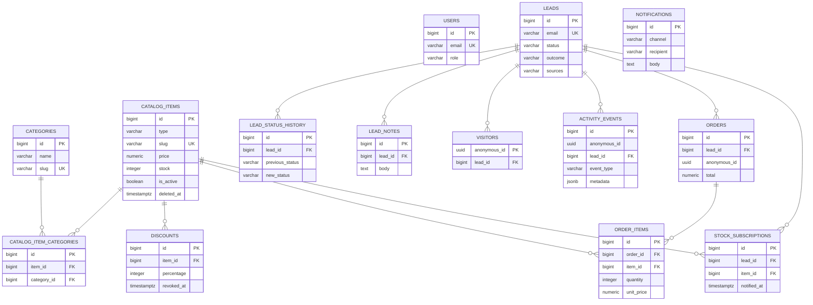

# Modelo de datos — Xtrim

Documentación del esquema de PostgreSQL del proyecto: qué tablas existen, qué guarda cada
columna, cómo se relacionan y qué reglas de negocio están grabadas en la base.

> **Fuente de la verdad.** El esquema lo posee **Flyway** (`backend/src/main/resources/db/migration/`)
> y Hibernate solo lo **valida** al arrancar (`ddl-auto=validate`). Este documento describe el
> estado resultante de aplicar las migraciones `V1` a `V4`; no es una propuesta, es una foto del
> esquema real.

---

## Índice

- [Panorama](#panorama)
- [Diagrama entidad-relación](#diagrama-entidad-relación)
- [Diccionario de tablas](#diccionario-de-tablas)
  - [Seguridad: `users`](#seguridad-users)
  - [Catálogo: `categories`, `catalog_items`, `catalog_item_categories`, `discounts`](#catálogo)
  - [Leads y CRM: `leads`, `lead_status_history`, `lead_notes`](#leads-y-crm)
  - [Tracking: `visitors`, `activity_events`](#tracking)
  - [Compras: `orders`, `order_items`](#compras)
  - [Notificaciones: `stock_subscriptions`, `notifications`](#notificaciones)
- [Relaciones y borrados en cascada](#relaciones-y-borrados-en-cascada)
- [Enumeraciones y valores permitidos](#enumeraciones-y-valores-permitidos)
- [Índices](#índices)
- [Reglas de negocio grabadas en el esquema](#reglas-de-negocio-grabadas-en-el-esquema)
- [Notas y observaciones](#notas-y-observaciones)
- [Cómo consultar y verificar](#cómo-consultar-y-verificar)

---

## Panorama

Catorce tablas de negocio, agrupadas en seis dominios, más la tabla técnica de Flyway.

| Dominio | Tablas | Qué representa |
| --- | --- | --- |
| **Seguridad** | `users` | Las cuentas del personal que entran al panel. |
| **Catálogo** | `categories`, `catalog_items`, `catalog_item_categories`, `discounts` | Productos y servicios unificados, sus categorías y sus descuentos. |
| **Leads / CRM** | `leads`, `lead_status_history`, `lead_notes` | Las personas que mostraron intención, su pipeline y las notas del equipo. |
| **Tracking** | `visitors`, `activity_events` | El visitante anónimo y todo lo que hizo antes de dar su contacto. |
| **Compras** | `orders`, `order_items` | La compra simulada y el detalle congelado de sus líneas. |
| **Notificaciones** | `stock_subscriptions`, `notifications` | Los avisos de reposición y la bandeja de mensajes simulados. |
| *(técnica)* | `flyway_schema_history` | El registro de migraciones aplicadas. No se documenta como tabla de negocio. |

Convenciones del esquema:

- Las claves primarias son `bigserial` (`bigint` + secuencia), salvo `visitors`, cuya PK es el
  `anonymous_id` (`uuid`) que genera el navegador.
- El dinero es `numeric(12, 2)`; nunca `float`.
- Las fechas son `timestamptz` (con zona horaria), siempre en UTC.
- Los documentos variables —imágenes, especificaciones, metadatos de eventos— viven en `jsonb`.
- El borrado del catálogo es **lógico** (`deleted_at`): la fila sobrevive porque los pedidos la
  referencian.

---

## Diagrama entidad-relación



> El significado de cada línea está en la tabla de
> [relaciones y borrados en cascada](#relaciones-y-borrados-en-cascada). Versión renderizada:
> [`modelo-entidad-relacion.svg`](modelo-entidad-relacion.svg) (también en
> [`PNG`](modelo-entidad-relacion.png)).
>
> `users` no tiene relaciones: el JWT lleva el rol y el panel no guarda qué persona hizo qué

---

## Diccionario de tablas

### Seguridad: `users`

**Qué guarda.** Las cuentas del personal que entran por `/api/auth/login`. No son clientes: los
clientes son `leads`.

| Columna | Tipo | Nulo | Default | Descripción |
| --- | --- | --- | --- | --- |
| `id` | `bigserial` | no | secuencia | PK. |
| `email` | `varchar(255)` | no | — | Identidad de login. **UNIQUE.** |
| `password_hash` | `varchar(255)` | no | — | Hash BCrypt. Nunca se guarda la contraseña. |
| `display_name` | `varchar(255)` | no | — | Nombre visible en el panel. |
| `role` | `varchar(32)` | no | — | Rol. Hoy solo `ADMIN` (ver [V4](#notas-y-observaciones)). |
| `created_at` | `timestamptz` | no | `now()` | Alta de la cuenta. |

**Restricciones.**
`ck_users_role check (role = 'ADMIN')` — tras `V4` el único rol válido es `ADMIN`.

---

### Catálogo

#### `categories`

**Qué guarda.** Las categorías con las que se navega y se filtra el catálogo.

| Columna | Tipo | Nulo | Default | Descripción |
| --- | --- | --- | --- | --- |
| `id` | `bigserial` | no | secuencia | PK. |
| `name` | `varchar(255)` | no | — | Nombre visible. |
| `slug` | `varchar(255)` | no | — | Identificador para la URL. **UNIQUE.** |
| `created_at` | `timestamptz` | no | `now()` | Alta. |

---

#### `catalog_items`

**Qué guarda.** El catálogo unificado: **productos y servicios son la misma entidad** y se
distinguen por `type`. Es la tabla que más se lee del sistema.

| Columna | Tipo | Nulo | Default | Descripción |
| --- | --- | --- | --- | --- |
| `id` | `bigserial` | no | secuencia | PK. |
| `type` | `varchar(32)` | no | — | `PRODUCT` o `SERVICE` (CHECK). |
| `name` | `varchar(255)` | no | — | Nombre visible. |
| `slug` | `varchar(255)` | no | — | Identificador de la URL. **UNIQUE.** |
| `description` | `text` | no | `''` | Descripción larga. |
| `price` | `numeric(12,2)` | no | — | Precio de lista. CHECK `>= 0`. El descuento **no** se guarda aquí. |
| `stock` | `integer` | **sí** | — | `NULL` = stock **no controlado**; `0` = **agotado**. CHECK `stock is null or stock >= 0`. |
| `images` | `jsonb` | no | `'[]'` | Lista JSON de URLs de imagen. |
| `specs` | `jsonb` | no | `'[]'` | Lista JSON de `{ "name": "...", "value": "..." }`. |
| `search_text` | `text` | no | `''` | Nombre + descripción en minúsculas y sin tildes; es la columna que busca el catálogo. |
| `is_featured` | `boolean` | no | `false` | Destacado: alimenta el carrusel de la home. |
| `is_active` | `boolean` | no | `true` | Publicado/visible. Es reversible y **no** borra. |
| `deleted_at` | `timestamptz` | sí | — | Borrado lógico. Si tiene valor, el ítem no se lista. |
| `created_at` | `timestamptz` | no | `now()` | Alta. |
| `updated_at` | `timestamptz` | no | `now()` | Última modificación (la mantiene Hibernate). |
| `sales_count` | `integer` | no | `0` | Proyección de «más comprado»: unidades confirmadas. Hoy solo tiene los valores sembrados (ver notas). |

**Restricciones.**
- `ck_catalog_items_type`: `type in ('PRODUCT','SERVICE')`.
- `catalog_items_price_check`: `price >= 0`.
- `ck_catalog_items_stock`: `stock is null or stock >= 0`.
- `catalog_items_slug_key`: `slug` único.

**Notas.**
- Un ítem puede estar `is_active = false` (despublicado) sin estar borrado; y `deleted_at` no nulo
  implica borrado lógico. Las consultas públicas exigen ambas cosas.
- `search_text` lo calcula la aplicación al escribir; no hay trigger ni extensión de PostgreSQL.
- `sales_count` es una **proyección**, no la fuente de verdad: evita que el catálogo consulte las
  tablas de pedidos. Ver [la nota sobre su actualización](#sales_count-no-se-actualiza-al-comprar).

---

#### `catalog_item_categories`

**Qué guarda.** La relación **N:M** entre ítems y categorías (tabla puente con PK propia).

| Columna | Tipo | Nulo | Default | Descripción |
| --- | --- | --- | --- | --- |
| `id` | `bigserial` | no | secuencia | PK. |
| `item_id` | `bigint` | no | — | FK → `catalog_items.id`, `ON DELETE CASCADE`. |
| `category_id` | `bigint` | no | — | FK → `categories.id`, `ON DELETE CASCADE`. |
| `created_at` | `timestamptz` | no | `now()` | Alta del vínculo. |

**Nota.** No existe un `UNIQUE (item_id, category_id)`: la aplicación reemplaza el conjunto de
categorías de un ítem y evita duplicados al escribir. Ver [observaciones](#notas-y-observaciones).

---

#### `discounts`

**Qué guarda.** Los descuentos de un ítem. Aplicar uno nuevo **revoca** el anterior en vez de
borrarlo, así que la tabla conserva el historial.

| Columna | Tipo | Nulo | Default | Descripción |
| --- | --- | --- | --- | --- |
| `id` | `bigserial` | no | secuencia | PK. |
| `item_id` | `bigint` | no | — | FK → `catalog_items.id`, `ON DELETE CASCADE`. |
| `percentage` | `integer` | no | — | Porcentaje 0–100 (CHECK). |
| `starts_at` | `timestamptz` | sí | — | Inicio de vigencia; `NULL` = sin fecha de inicio. |
| `ends_at` | `timestamptz` | sí | — | Fin de vigencia; `NULL` = sin fecha de fin. |
| `revoked_at` | `timestamptz` | sí | — | Revocación explícita; un descuento revocado ya no aplica. |
| `created_at` | `timestamptz` | no | `now()` | Alta. |

**Regla de vigencia (la aplica la consulta, no un constraint).** Un descuento está vigente si
`revoked_at is null` y `now()` cae dentro de `[starts_at, ends_at]` (extremos abiertos si son
`NULL`). El precio final se calcula **en el servidor** al leer; el cliente nunca manda precios.

**Invariante de negocio.** Un solo descuento vigente por ítem: al aplicar uno nuevo, el servicio
sella `revoked_at = now()` en el anterior y luego inserta el nuevo.

---

### Leads y CRM

#### `leads`

**Qué guarda.** Las personas que mostraron intención. El **correo es la identidad**: la misma
persona desde dos dispositivos es **un** lead con **dos** orígenes.

| Columna | Tipo | Nulo | Default | Descripción |
| --- | --- | --- | --- | --- |
| `id` | `bigserial` | no | secuencia | PK. |
| `name` | `varchar(255)` | no | — | Nombre de la persona. |
| `email` | `varchar(255)` | no | — | Identidad del lead. **UNIQUE.** |
| `phone` | `varchar(64)` | sí | — | Teléfono. |
| `province` | `varchar(64)` | sí | — | Provincia (nombre del enum, p. ej. `PICHINCHA`). |
| `status` | `varchar(32)` | no | `'NEW'` | Estado del pipeline: `NEW`, `IN_PROGRESS`, `CLOSED` (CHECK). |
| `sources` | `varchar(255)` | no | `''` | Orígenes acumulados, **separados por comas** (`CHECKOUT,STOCK_NOTIFY`). |
| `sale_amount` | `numeric(12,2)` | no | `0` | Monto de la venta cuando se cierra como ganada. |
| `outcome` | `varchar(32)` | sí | — | Resultado al cerrar: `WON` o `LOST` (CHECK). |
| `consent` | `boolean` | no | `false` | Consentimiento de contacto. |
| `created_at` | `timestamptz` | no | `now()` | Alta. |
| `updated_at` | `timestamptz` | no | `now()` | Última modificación. |

**Restricciones.**
- `leads_email_key`: `email` único (la base impide duplicados).
- `ck_leads_status`: `status in ('NEW','IN_PROGRESS','CLOSED')`.
- `ck_leads_outcome`: `outcome is null or outcome in ('WON','LOST')`.

**Máquina de estados.** `NEW → IN_PROGRESS → CLOSED` (con `WON` o `LOST`), más la reapertura
`CLOSED → IN_PROGRESS`. `NEW → CLOSED` no existe: la regla vive en el dominio, no en el esquema.
El `outcome` solo tiene sentido con `status = 'CLOSED'`.

---

#### `lead_status_history`

**Qué guarda.** Cada transición de estado de un lead: el rastro del pipeline.

| Columna | Tipo | Nulo | Default | Descripción |
| --- | --- | --- | --- | --- |
| `id` | `bigserial` | no | secuencia | PK. |
| `lead_id` | `bigint` | no | — | FK → `leads.id`, `ON DELETE CASCADE`. |
| `previous_status` | `varchar(32)` | sí | — | Estado anterior. El esquema lo admite nulo; hoy toda fila nace de una transición y lo trae informado. |
| `new_status` | `varchar(32)` | no | — | Estado nuevo. |
| `changed_by` | `varchar(255)` | no | `'SISTEMA'` | Autor del cambio (hoy `SISTEMA` o el usuario del token). |
| `changed_at` | `timestamptz` | no | `now()` | Momento del cambio. |

---

#### `lead_notes`

**Qué guarda.** Las notas libres que el equipo escribe sobre un lead.

| Columna | Tipo | Nulo | Default | Descripción |
| --- | --- | --- | --- | --- |
| `id` | `bigserial` | no | secuencia | PK. |
| `lead_id` | `bigint` | no | — | FK → `leads.id`, `ON DELETE CASCADE`. |
| `body` | `text` | no | — | Texto de la nota. |
| `author` | `varchar(255)` | no | `'SISTEMA'` | Autor. |
| `created_at` | `timestamptz` | no | `now()` | Alta. |

---

### Tracking

#### `visitors`

**Qué guarda.** Un visitante anónimo, identificado por el UUID que el navegador guarda. Cuando da
su correo, el visitante se **vincula** a un lead.

| Columna | Tipo | Nulo | Default | Descripción |
| --- | --- | --- | --- | --- |
| `anonymous_id` | `uuid` | no | — | **PK.** Lo genera el navegador. |
| `lead_id` | `bigint` | sí | — | FK → `leads.id`, `ON DELETE SET NULL`. `NULL` mientras es anónimo. |
| `created_at` | `timestamptz` | no | `now()` | Primera vez visto. |
| `last_seen_at` | `timestamptz` | no | `now()` | Última actividad. |

**Cardinalidad.** Un lead puede tener **varios** visitantes (móvil + escritorio), pero cada
visitante apunta a un solo lead.

---

#### `activity_events`

**Qué guarda.** El historial de comportamiento: solo inserciones, nunca actualizaciones. Es la
tabla que alimenta la línea de tiempo del CRM y la que más crece.

| Columna | Tipo | Nulo | Default | Descripción |
| --- | --- | --- | --- | --- |
| `id` | `bigserial` | no | secuencia | PK. |
| `anonymous_id` | `uuid` | no | — | Visitante que hizo el evento. **Sin FK** (ver notas). |
| `lead_id` | `bigint` | sí | — | FK → `leads.id`, `ON DELETE SET NULL`. Se rellena al atribuir el evento a un lead. |
| `event_type` | `varchar(64)` | no | — | Tipo de evento (ver enumeraciones). |
| `entity_type` | `varchar(64)` | sí | — | Sobre qué entidad actuó, p. ej. `CATALOG_ITEM`. |
| `entity_id` | `bigint` | sí | — | Id de esa entidad. |
| `metadata` | `jsonb` | no | `'{}'` | Contexto libre: término buscado, cantidad, etc. |
| `created_at` | `timestamptz` | no | `now()` | Momento del evento. |

**Nota.** `entity_id` no es una FK polimórfica: apunta a `catalog_items` u otra tabla según
`entity_type`, y por eso no puede declararse como constraint.

---

### Compras

#### `orders`

**Qué guarda.** La cabecera de la compra simulada. No hay pasarela de pago.

| Columna | Tipo | Nulo | Default | Descripción |
| --- | --- | --- | --- | --- |
| `id` | `bigserial` | no | secuencia | PK. |
| `lead_id` | `bigint` | sí | — | FK → `leads.id`, `ON DELETE SET NULL`. Quien compró, si se identificó. |
| `anonymous_id` | `uuid` | sí | — | Visitante que compró. **Sin FK.** |
| `total` | `numeric(12,2)` | no | `0` | Total cobrado (suma de `order_items.line_total`). |
| `item_count` | `integer` | no | `0` | Número de unidades. |
| `created_at` | `timestamptz` | no | `now()` | Momento de la compra. |

**Nota.** `total` e `item_count` están desnormalizados para que el listado y los indicadores no
tengan que sumar las líneas en cada lectura.

---

#### `order_items`

**Qué guarda.** Las líneas de un pedido, con el **nombre y el precio congelados** en el momento de
la compra: si el catálogo cambia después, el pedido no cambia.

| Columna | Tipo | Nulo | Default | Descripción |
| --- | --- | --- | --- | --- |
| `id` | `bigserial` | no | secuencia | PK. |
| `order_id` | `bigint` | no | — | FK → `orders.id`, `ON DELETE CASCADE`. |
| `item_id` | `bigint` | no | — | FK → `catalog_items.id`. **Sin cascade**: un ítem referenciado no se puede borrar físicamente. |
| `item_name` | `varchar(255)` | no | — | Copia del nombre al comprar. |
| `quantity` | `integer` | no | — | Unidades. CHECK `> 0`. |
| `unit_price` | `numeric(12,2)` | no | — | Precio unitario **final** (con descuento) al comprar. CHECK `>= 0`. |
| `line_total` | `numeric(12,2)` | no | — | `quantity × unit_price`. CHECK `>= 0`. |

---

### Notificaciones

#### `stock_subscriptions`

**Qué guarda.** Quién pidió que le avisen cuando un ítem agotado vuelva.

| Columna | Tipo | Nulo | Default | Descripción |
| --- | --- | --- | --- | --- |
| `id` | `bigserial` | no | secuencia | PK. |
| `lead_id` | `bigint` | no | — | FK → `leads.id`, `ON DELETE CASCADE`. |
| `item_id` | `bigint` | no | — | FK → `catalog_items.id`, `ON DELETE CASCADE`. |
| `notified_at` | `timestamptz` | sí | — | Cuándo se envió el aviso; `NULL` = pendiente. |
| `created_at` | `timestamptz` | no | `now()` | Alta de la suscripción. |

**Restricción.** `uq_stock_subscription unique (lead_id, item_id)`: una persona no puede
suscribirse dos veces al mismo ítem.

---

#### `notifications`

**Qué guarda.** La bandeja de mensajes **simulados** (no se envía correo real todavía). Es el
adaptador de salida del puerto `StockNotificationSender`: hoy escribe una fila y una línea de log.

| Columna | Tipo | Nulo | Default | Descripción |
| --- | --- | --- | --- | --- |
| `id` | `bigserial` | no | secuencia | PK. |
| `channel` | `varchar(32)` | no | `'LOG'` | Canal. Hoy solo `LOG`. |
| `recipient` | `varchar(255)` | no | — | Destinatario (correo). |
| `subject` | `varchar(255)` | no | — | Asunto. |
| `body` | `text` | no | — | Cuerpo del mensaje. |
| `created_at` | `timestamptz` | no | `now()` | Alta. |

**Nota.** No tiene FK a `leads` ni a `stock_subscriptions`: guarda una copia del mensaje tal como
se generó, y así el histórico sobrevive aunque el lead o la suscripción desaparezcan.

---

## Relaciones y borrados en cascada

| Tabla hija | Columna | Tabla padre | Cardinalidad | `ON DELETE` | Efecto |
| --- | --- | --- | --- | --- | --- |
| `catalog_item_categories` | `item_id` | `catalog_items` | N:1 | `CASCADE` | Al borrar un ítem físicamente, sus vínculos se van. |
| `catalog_item_categories` | `category_id` | `categories` | N:1 | `CASCADE` | Al borrar una categoría, sus vínculos se van. |
| `discounts` | `item_id` | `catalog_items` | N:1 | `CASCADE` | Los descuentos siguen al ítem. |
| `lead_status_history` | `lead_id` | `leads` | N:1 | `CASCADE` | El historial no sobrevive al lead. |
| `lead_notes` | `lead_id` | `leads` | N:1 | `CASCADE` | Las notas no sobreviven al lead. |
| `visitors` | `lead_id` | `leads` | N:1 (nullable) | `SET NULL` | El visitante queda anónimo si el lead se borra. |
| `activity_events` | `lead_id` | `leads` | N:1 (nullable) | `SET NULL` | El evento se conserva, sin atribución. |
| `orders` | `lead_id` | `leads` | N:1 (nullable) | `SET NULL` | El pedido se conserva como venta anónima. |
| `order_items` | `order_id` | `orders` | N:1 | `CASCADE` | Las líneas no existen sin su pedido. |
| `order_items` | `item_id` | `catalog_items` | N:1 | `NO ACTION` | Un ítem vendido no se puede borrar físicamente. |
| `stock_subscriptions` | `lead_id` | `leads` | N:1 | `CASCADE` | La suscripción no sobrevive al lead. |
| `stock_subscriptions` | `item_id` | `catalog_items` | N:1 | `CASCADE` | La suscripción no sobrevive al ítem. |

**Relaciones lógicas sin FK declarada.** `visitors.anonymous_id`, `activity_events.anonymous_id`
y `orders.anonymous_id` identifican al visitante, pero **no** son claves foráneas a `visitors`.
Es deliberado: un evento puede llegar antes de que exista la fila del visitante (o después de que
se purgue), y el tracking nunca debe fallar por integridad referencial.

---

## Enumeraciones y valores permitidos

| Campo | Valores | Dónde se valida |
| --- | --- | --- |
| `catalog_items.type` | `PRODUCT`, `SERVICE` | CHECK en BD. |
| `leads.status` | `NEW`, `IN_PROGRESS`, `CLOSED` | CHECK en BD + máquina de estados en el dominio. |
| `leads.outcome` | `WON`, `LOST` (o `NULL`) | CHECK en BD. |
| `leads.sources` | `CHECKOUT`, `STOCK_NOTIFY`, `INFO_REQUEST`, `WHATSAPP`, `MANUAL` | Enum de la aplicación, guardado como CSV. |
| `leads.province` | `AZUAY`, `BOLIVAR`, `CARCHI`, `COTOPAXI`, `EL_ORO`, `ESMERALDAS`, `GALAPAGOS`, `GUAYAS`, `IMBABURA`, `LOJA`, `LOS_RIOS`, `MANABI`, `MORONA_SANTIAGO`, `NAPO`, `ORELLANA`, `PICHINCHA`, `SANTA_ELENA`, `SUCUMBIOS`, `TUNGURAHUA`, `ZAMORA_CHINCHIPE` | Enum de la aplicación; **sin CHECK** en BD. |
| `activity_events.event_type` | `SEARCH`, `PRODUCT_VIEW`, `ADD_TO_CART`, `REMOVE_FROM_CART`, `PURCHASE`, `STOCK_SUBSCRIBE`, `INFO_REQUEST` | Enum de la aplicación; **sin CHECK** en BD. |
| `notifications.channel` | `LOG` | Solo valor usado; sin CHECK en BD. |

> Los enums de `province`, `event_type`, `sources` y `channel` no tienen constraint en la base:
> los controla la aplicación al escribir. Si se quisiera blindar el esquema, el paso sería añadir
> un CHECK (o tablas de catálogo) en una migración nueva.

---

## Índices

Además de las PK y los `UNIQUE` implícitos, el esquema crea estos índices:

| Tabla | Índice | Columnas | Para qué |
| --- | --- | --- | --- |
| `users` | `users_email_key` | `email` (único) | Login por correo. |
| `categories` | `categories_slug_key` | `slug` (único) | Resolver la categoría por URL. |
| `catalog_items` | `catalog_items_slug_key` | `slug` (único) | Detalle por URL. |
| `catalog_items` | `ix_catalog_items_slug` | `slug` | Redundante con el único; soporta el listado de slugs. |
| `catalog_items` | `ix_catalog_items_type` | `type` | Filtro productos/servicios. |
| `catalog_items` | `ix_catalog_items_active` | `is_active, deleted_at` | Listado público (publicados y no borrados). |
| `catalog_items` | `ix_catalog_items_search` | `search_text` | Búsqueda `LIKE` normalizada. |
| `catalog_item_categories` | `ix_catalog_item_categories_category` | `category_id` | Ítems de una categoría. |
| `discounts` | `ix_discounts_item` | `item_id` | Descuento vigente por ítem. |
| `leads` | `leads_email_key` | `email` (único) | Identidad del lead y upsert por correo. |
| `leads` | `ix_leads_status` | `status` | Kanban y filtros por estado. |
| `leads` | `ix_leads_province` | `province` | Filtro por provincia. |
| `leads` | `ix_leads_created_at` | `created_at` | Filtro y orden por fecha de alta. |
| `lead_status_history` | `ix_lead_status_history_lead` | `lead_id` | Línea de tiempo de un lead. |
| `lead_notes` | `ix_lead_notes_lead` | `lead_id` | Notas de un lead. |
| `visitors` | `ix_visitors_lead` | `lead_id` | Visitantes de un lead. |
| `activity_events` | `ix_activity_events_anonymous` | `anonymous_id` | Historial de un visitante. |
| `activity_events` | `ix_activity_events_lead` | `lead_id` | Línea de tiempo del CRM. |
| `activity_events` | `ix_activity_events_created_at` | `created_at` | Ventanas de tiempo y archivado. |
| `orders` | `ix_orders_lead` | `lead_id` | Pedidos de un lead. |
| `orders` | `ix_orders_created_at` | `created_at` | Indicadores por fecha. |
| `order_items` | `ix_order_items_order` | `order_id` | Líneas de un pedido. |
| `order_items` | `ix_order_items_item` | `item_id` | Ventas de un ítem. |
| `stock_subscriptions` | `uq_stock_subscription` | `lead_id, item_id` (único) | Evitar suscripciones duplicadas. |
| `stock_subscriptions` | `ix_stock_subscriptions_item` | `item_id` | A quién avisar cuando vuelve el stock. |

> `ix_catalog_items_slug` repite el índice que ya crea `UNIQUE (slug)`. Es inocuo pero redundante;
> se podría retirar en una migración futura sin cambiar el comportamiento.

---

## Reglas de negocio grabadas en el esquema

1. **Catálogo unificado.** `type` distingue `PRODUCT` de `SERVICE`; todo lo demás es común. No hay
   dos tablas que mantener en paralelo.
2. **El stock es opcional, pero nunca ambiguo.** `NULL` = no se controla; `0` = agotado. El CHECK
   impide negativos.
3. **Borrado lógico.** `deleted_at` conserva la fila y el historial de pedidos. La despublicación
   (`is_active = false`) es distinta y reversible.
4. **El precio lo posee el servidor.** `price` es el precio de lista; el descuento vive en
   `discounts` y se aplica al leer, contra la fecha actual. Nunca se guarda un precio «final» en el
   catálogo.
5. **Un descuento vigente por ítem.** El nuevo revoca el anterior (`revoked_at`), y así queda el
   historial sin borrar nada.
6. **El correo es la identidad del lead.** `UNIQUE (email)` permite el *upsert* y une la actividad
   de varios dispositivos en una sola persona.
7. **Los orígenes se acumulan.** `sources` guarda un CSV; la aplicación parsea, une y serializa.
8. **La máquina de estados vive en el servidor.** El esquema limita los valores; el orden de las
   transiciones lo impone el dominio.
9. **El tracking es anónimo primero.** `visitors` y `activity_events` existen sin lead; el lead es
   un enriquecimiento posterior (`lead_id` nullable).
10. **El pedido es un documento congelado.** `order_items` copia nombre y precio; el catálogo puede
    cambiar sin reescribir la historia.
11. **Una suscripción por persona e ítem.** `UNIQUE (lead_id, item_id)`.
12. **El «más comprado» es una proyección.** `sales_count` evita cruzar dominios en cada lectura del
    catálogo; hoy solo tiene los valores sembrados (ver [notas](#sales_count-no-se-actualiza-al-comprar)).

---

## Notas y observaciones

### `sources` es un CSV, no una tabla puente

Se guarda como `varchar` con valores separados por comas (`CHECKOUT,INFO_REQUEST`). Ventajas: una
sola fila por lead y escritura simple. Coste: no se puede indexar por origen ni hacer `JOIN` limpio;
para reportes por origen hay que usar `string_to_array`/`unnest` o migrar a una tabla
`lead_sources (lead_id, source)`.

### Falta un `UNIQUE` en la tabla puente del catálogo

`catalog_item_categories` no declara `UNIQUE (item_id, category_id)`. La aplicación reemplaza el
conjunto de categorías al guardar y comprueba duplicados, así que en la práctica no se repiten;
pero la base no lo impide. Añadirlo sería una migración de una línea.

### `sales_count` no se actualiza al comprar

La columna existe, el catálogo ordena por ella en «más comprado» y `V2__seed_catalog.sql` la
siembra con valores; pero **ningún caso de uso la incrementa** al confirmar un pedido. En una base
con datos reales, el orden «más comprado» quedaría congelado en esos valores iniciales. La fuente
de verdad siempre fue `order_items`; para que la proyección vuelva a moverse, el checkout tendría
que incrementarla en la misma transacción en la que descuenta el stock.

### `province` cubre 20 de las 24 provincias de Ecuador

El enum de la aplicación no incluye `CAÑAR`, `CHIMBORAZO`, `PASTAZA` ni
`SANTO_DOMINGO_DE_LOS_TSACHILAS`. La columna no tiene CHECK, así que la base aceptaría cualquier
texto; la restricción real está en el enum. Si se necesita el país completo, se amplía el enum (y
opcionalmente se añade el CHECK).

### Los identificadores anónimos no son FK

`visitors.anonymous_id` es PK, pero `activity_events.anonymous_id` y `orders.anonymous_id` no
referencian `visitors`. Es una decisión de disponibilidad: el registro de actividad no puede
fallar por una fila de visitante ausente, y el evento se conserva aunque el visitante se purgue.

### `updated_at` no tiene trigger

Lo mantiene Hibernate (`@LastModifiedDate`) al escribir la entidad. Un `UPDATE` directo en SQL no
lo actualiza. Por eso las reglas de escritura —y el descuento de stock con bloqueo
`PESSIMISTIC_WRITE`— pasan siempre por la entidad.

---

## Cómo consultar y verificar

Con la pila local levantada (`docker compose up -d`), la base escucha en el puerto que indique
`.env` (por defecto en este repo, `5433`):

```bash
# Entrar a psql
docker exec -it xtrim-postgres-1 psql -U xtrim -d xtrim

# Listar tablas
\dt

# Ver la definición completa de una tabla (columnas, índices, FKs, checks)
\d+ catalog_items

# Confirmar qué migraciones se aplicaron
select installed_rank, version, description, success from flyway_schema_history order by installed_rank;
```

Para regenerar este documento tras un cambio de esquema:

1. Añadir la migración en `backend/src/main/resources/db/migration/` (nunca editar una ya aplicada).
2. Arrancar la API: Flyway aplica la migración, Hibernate valida el mapeo.
3. Actualizar el diagrama y el diccionario con la nueva estructura.

El diagrama Mermaid se renderiza directamente en GitHub, GitLab, Obsidian y en los visores de
Markdown que soportan Mermaid; el resto de visores muestra el bloque como código.
